# VXC ADV Controller: Scientific Data Roadmap & Research Logic Specification

**Document Status:** Living Scientific Specification  
**Version:** 2.0.0 (Research Grade)  
**Author:** Hydraulic Research Engineering Pair Programming  
**Last Updated:** 2026-09-18  

---

## 1. Executive Summary & Scientific Purpose

The **VXC ADV Controller** integrates a two-axis computer-controlled cart (Velmex VXC positioning traverse) with a 3D Acoustic Doppler Velocimeter (ADV; SonTek FlowTracker2, Nortek Vectrino, or SonTek 16-MHz ADV) to acquire high-density spatial velocity vector fields in open-channel hydraulic flumes.

In open-channel flume research, raw acoustic Doppler velocity measurements are subject to:
1. Doppler instrument white noise floors inflating apparent turbulence,
2. Acoustic boundary reflections and air-entrainment spike anomalies,
3. Multi-beam geometric reconstruction vulnerabilities,
4. Carriage mechanical vibration and settling transients,
5. Probe mounting pitch/roll/yaw misalignments,
6. Between-run discharge and temperature drift during multi-visit grid sampling.

To ensure laboratory measurements meet the standards of peer-reviewed fluid dynamics literature (USGS TM 3-A4, ASCE Journal of Hydraulic Engineering, Journal of Atmospheric and Oceanic Technology), every raw data point passes through a rigorous, deterministic sequence of mathematical filters and statistical corrections.

This document serves as the **living data roadmap**, detailing every mathematical transformation, filtering gate, classification rule, coordinate system, and physical assumption embedded in the software.

---

## 2. Complete Data Roadmap Architecture

```mermaid
flowchart TD
    subgraph Raw Acquisition
        A1["Raw ADV Stream (10 Hz)<br/>(t_adv, u_p, v_p, w_p, Beams c_i, SNR_i)"]
        A2["VXC Hardware Polling (2 Hz)<br/>(Motor 1=Y, Motor 2=X)"]
    end

    subgraph Stage 1: Position Ingestion & Sanitization
        A2 --> B1{"Serial Valid?"}
        B1 -- "Yes (x, y)" --> B2["Convert steps to meters<br/>K = 48,000 steps/ft<br/>Label: 'GOOD'"]
        B1 -- "Timeout / CRC Drop" --> B3["Increment Error Count<br/>Suppress (0,0) Injection<br/>Skip Write"]
        B2 --> B4[("vxc_pos_*.csv")]
    end

    subgraph Stage 2: Temporal Synchronization
        A1 --> C1["Read ADV Timestamps<br/>UTC Datetime (ISO 8601)"]
        B4 --> C2["Sorted VXC Timestamps"]
        C1 & C2 --> C3["Nearest-Neighbor Bisect Search<br/>|t_adv - t_vxc| <= tolerance (0.5 s)"]
        C3 --> C4[("master_merged.csv<br/>Raw Matched Samples")]
    end

    subgraph Stage 3: Spatial Dwell Segmentation
        C4 --> D1{"vxc_quality == 'GOOD'?"}
        D1 -- "No ('VXC Moving')" --> D2["Exclude from Dwell Segments"]
        D1 -- "Yes" --> D3["Euclidean Distance Check<br/>dist(r_i, r_{i-1}) > 5 mm"]
        D3 -- "> 5 mm" --> D4["New Position Segment"]
        D3 -- "<= 5 mm" --> D5["Append to Current Segment"]
        D4 & D5 --> D6["Compute Spatial Centroid<br/>x_bar = mean(x_i), y_bar = mean(y_i)<br/>Preserve arrival anchor (x_1, y_1)"]
    end

    subgraph Stage 4: Acoustic Beam Filtering
        D6 --> E1["Per-Sample Beam Gate (USGS TM 3-A4)<br/>min(c_1, c_2, c_3) >= corr_gate<br/>min(SNR_1, SNR_2, SNR_3) >= snr_gate"]
        E1 -- "Pass" --> E2["Filtered Segment Samples"]
        E1 -- "Fail" --> E3["Discard from Filtered Output"]
    end

    subgraph Stage 5: Phase-Space Despiking
        E2 --> F1{"Segment Length N >= 10?"}
        F1 -- "Yes" --> F2["Goring & Nikora (2002) / Wahl (2003) PST<br/>Poincare Phase-Space (u, Du, D2u)<br/>Universal Threshold lambda_U = sqrt(2 ln N)<br/>Wahl MAD Scale: sigma = 1.4826 * MAD"]
        F1 -- "No" --> F3["Pass Through Raw Velocities"]
        F2 --> F4["Clean Instantaneous Velocities<br/>(u_clean, v_clean, w_clean)"]
        F3 --> F4
    end

    subgraph Stage 6: Coordinate Misalignment Correction
        F4 --> G1{"Roll, Pitch, or Yaw != 0?"}
        G1 -- "Yes" --> G2["Tait-Bryan Rotation Matrix R<br/>V_flume = R * V_probe"]
        G1 -- "No (0,0,0)" --> G3["Identity R = I"]
        G2 & G3 --> G4["Flume-Aligned Velocities (u, v, w)"]
    end

    subgraph Stage 7: Turbulence & Doppler Noise Correction
        G4 --> H1["Reynolds Decomposition<br/>u' = u - u_bar, etc.<br/>Measured Variances: var_x, var_y, var_z"]
        H1 --> H2{"N >= 32 & Noise Enabled?"}
        H2 -- "Yes" --> H3["Voulgaris & Trowbridge (1998) FFT<br/>Spectral Plateau S_floor = median(PSD_high)<br/>sigma_noise^2 = S_floor * (f_s / 2)"]
        H2 -- "No" --> H4["sigma_noise^2 = 0"]
        H3 & H4 --> H5["Subtract Noise from Normal Stresses<br/>var_clean = max(0, var_meas - sigma_noise^2)<br/>TKE_clean = 0.5 * sum(var_clean)"]
        H5 --> H6["Covariance cov(u'w') and Shear Stress<br/>tau_xz = -rho(T) * cov(u'w')<br/>(Shear stress uncorrected per V&T 1998)"]
        H6 --> H7[("master_averaged.csv /<br/>Filtered_Averages.csv")]
    end

    subgraph Stage 8: Multi-Visit Aggregation
        H7 --> I1["Group Measurements by Spatial Bin (x_loc, y_loc)"]
        I1 --> I2["Law of Total Variance<br/>var_tot = sum(N_i var_i)/N + sum(N_i (u_i - U)^2)/N<br/>TI_tot = sqrt(var_tot)"]
        I2 --> I3["Law of Total Covariance<br/>cov_tot = sum(N_i cov_i)/N + sum(N_i (u_i - U)(w_i - W))/N<br/>tau_tot = -rho_bar * cov_tot"]
        I3 --> I4["Weighted Average of Linear Fields<br/>(Velocities, SNR, Correlation, Temp, Press)"]
    end

    subgraph Stage 9: Quiver Vector Visualization
        I4 --> J1{"In-plane Speed V_inplane < 5 mm/s?"}
        J1 -- "Yes" --> J2["Classify as Stationary / Noise Floor<br/>Draw Neutral Dot (No Arrow)"]
        J1 -- "No" --> J3["Linear Proportional Scaling: L = scale * V<br/>Add Calibrated Reference Quiver Key<br/>Symbol: Downstream (x), Upstream (dot)"]
    end
```



---

## 3. Coordinate Systems & Kinematic Transformations

### 3.1 Motor Axis Mapping to Physical Space

The physical Velmex traverse utilizes two bipolar stepper motors driven by lead screws:
- **Motor 2 $\rightarrow$ Traverse X-Axis**: Horizontal cart motion across the flume span (transverse / width coordinate).
- **Motor 1 $\rightarrow$ Vertical Y-Axis**: Vertical mast motion controlling probe immersion depth (elevation / depth coordinate).

> [!CAUTION]
> **Motor Reversal Warning:**
> `move_absolute()` strictly commands Motor 2 for X targets and Motor 1 for Y targets. Reversing these motor commands physically drives the instrument mast into the flume sidewalls or bed.

### 3.2 Lead Screw Spatial Calibration

The Velmex lead screws have a standard mechanical pitch of 10 threads per inch, coupled to 400 step-per-revolution stepper motor configurations with full microstepping resolution:
$$\text{Resolution} = 10\text{ threads/in} \times 400\text{ microsteps/rev} = 4{,}000\text{ steps/in}$$
$$\text{Calibration Factor } K_{\text{cal}} = 4{,}000\text{ steps/in} \times 12\text{ in/ft} = 48{,}000\text{ steps/ft}$$

Conversion of motor step counts to SI displacement in meters:
$$x_{\text{m}} = \frac{x_{\text{steps}}}{48{,}000\text{ steps/ft}} \times 0.3048\text{ m/ft} = \frac{x_{\text{steps}}}{157{,}480.31496\text{ steps/m}}$$
$$y_{\text{m}} = \frac{y_{\text{steps}}}{48{,}000\text{ steps/ft}} \times 0.3048\text{ m/ft} = \frac{y_{\text{steps}}}{157{,}480.31496\text{ steps/m}}$$

### 3.3 Workspace Boundaries & Physical Envelope

The physical boundaries of the VXC traverse are parameterized in integer motor steps and converted to metric ranges:
- **Default Transverse Limits (X-Axis, Motor 2):**
  $$X_{\min} = 0\text{ steps} \quad (0.0000\text{ m})$$
  $$X_{\max} = 165{,}654\text{ steps} \quad (1.0519\text{ m})$$
- **Default Vertical Limits (Y-Axis, Motor 1):**
  $$Y_{\min} = 0\text{ steps} \quad (0.0000\text{ m})$$
  $$Y_{\max} = 57{,}651\text{ steps} \quad (0.3661\text{ m})$$

For any commanded metric target $(x_{\text{m}}, y_{\text{m}})$, target motor steps are computed and clamped:
$$x_{\text{steps}} = \text{clamp}\left(\text{round}\left(x_{\text{m}} \times \frac{48{,}000}{0.3048}\right), X_{\min}, X_{\max}\right)$$
$$y_{\text{steps}} = \text{clamp}\left(\text{round}\left(y_{\text{m}} \times \frac{48{,}000}{0.3048}\right), Y_{\min}, Y_{\max}\right)$$

### 3.4 Stepper Kinematics, Velocity Profile, & Transit Timing Formulation

The Velmex VXC controller executes sequential axis motion using ASCII motion blocks (`A{motor}M{accel}, S{motor}M{speed}, I{motor}M{steps}, R`).
- Default motion speed: $v_{\text{steps}} = 2{,}000\text{ steps/s}$ ($v \approx 0.0127\text{ m/s} = 1.27\text{ cm/s}$).
- Acceleration code: $A = 2$ (parameter scale $0\text{--}127$).
- Because the motion controller executes sequentially (moving transverse X first, then vertical Y):
  $$T_x = \frac{|\Delta x_{\text{steps}}|}{v_{\text{steps}}}, \quad T_y = \frac{|\Delta y_{\text{steps}}|}{v_{\text{steps}}}$$
  $$T_{\text{transit}} = 1.10 \times (T_x + T_y) + 0.50\text{ s}$$
  *(where $1.10$ accounts for acceleration/deceleration trapezoidal ramping, and $0.50\text{ s}$ covers serial command transmission, controller parsing, and buffer clearing).*

For an entire survey of $P$ points with dwell duration $T_{\text{dwell}}$ and settling duration $T_{\text{settling}}$, the remaining experiment time is predicted via:
$$\text{ETA}(i) = \sum_{j=i}^{P} \left( T_{\text{transit}}(j-1 \to j) + T_{\text{settling}} + T_{\text{dwell}} \right)$$

### 3.5 Automated Route Generation & Boustrophedon Scanning Geometry

The automated path generator creates dense 1D lines or 2D grid routes across the cross-section:
1. **Vertical Profile (1D line at fixed $x_{\text{fixed}}$):**
   $$y_k = y_{\text{start}} + k \left(\frac{y_{\text{end}} - y_{\text{start}}}{N_y - 1}\right), \quad k = 0, 1, \dots, N_y - 1$$
2. **Horizontal Profile (1D line at fixed $y_{\text{fixed}}$):**
   $$x_k = x_{\text{start}} + k \left(\frac{x_{\text{end}} - x_{\text{start}}}{N_x - 1}\right), \quad k = 0, 1, \dots, N_x - 1$$
3. **2D Boustrophedon (Snake) Grid ($N_x \times N_y$ stations):**
   To minimize non-productive travel time between survey rows, transverse scan direction alternates on successive vertical elevation rows:
   For vertical level $j = 0, 1, \dots, N_y - 1$ at elevation $y_j = y_{\text{start}} + j \Delta y$:
   $$\mathbf{x}_{\text{scan}}(j) = \begin{cases}
   \left[ x_{\text{start}} + k \Delta x \right]_{k=0}^{N_x - 1} & \text{if } j \text{ is even (left } \to \text{ right)} \\
   \left[ x_{\text{end}} - k \Delta x \right]_{k=0}^{N_x - 1} & \text{if } j \text{ is odd (right } \to \text{ left)}
   \end{cases}$$

### 3.6 Closed-Loop Accuracy Verification & Recovery Dynamics

Upon arrival at commanded station $(x_{\text{target}}, y_{\text{target}})$, actual motor positions are queried and evaluated against two-tier physical error tolerances:
$$\epsilon_x = |x_{\text{actual}} - x_{\text{target}}|, \quad \epsilon_y = |y_{\text{actual}} - y_{\text{target}}|$$
- **Tier 1 (Warning Threshold $\le 100\text{ steps} \approx 0.635\text{ mm}$):** Negligible backlash / microstep rounding. Logged as informational and scan proceeds.
- **Tier 2 (Hard Limit $> 500\text{ steps} \approx 3.175\text{ mm}$):** Indicates mechanical slip, lead screw obstruction, or stall. Scan pauses, raising an alert.
- **Exponential Backoff Re-attempt Loop:**
  $$\Delta t_{\text{retry}}(k) = 2^{k-1}\text{ seconds} \quad (k \in \{1, 2, 3\} \implies 1\text{ s}, 2\text{ s}, 4\text{ s})$$
  Status is re-verified (`verify_status()`) before each retry.

### 3.7 Probe Coordinate Misalignment Transformation

In shallow flumes or near boundary layers, researchers frequently pitch the probe head downward or roll the receiver mast to prevent boundary reflection or un-submergence of receiver arms. Any angular misalignment $(\phi, \theta, \psi)$ causes the dominant streamwise velocity to leak into the vertical and transverse components.

Let:
- $\phi$ = Roll angle around flume X-axis (streamwise) in degrees,
- $\theta$ = Pitch angle around flume Y-axis (transverse) in degrees,
- $\psi$ = Yaw angle around flume Z-axis (vertical) in degrees.

The three elementary rotation matrices are:
$$\mathbf{R}_x(\phi) = \begin{bmatrix} 1 & 0 & 0 \\ 0 & \cos\phi & -\sin\phi \\ 0 & \sin\phi & \cos\phi \end{bmatrix}, \quad \mathbf{R}_y(\theta) = \begin{bmatrix} \cos\theta & 0 & \sin\theta \\ 0 & 1 & 0 \\ -\sin\theta & 0 & \cos\theta \end{bmatrix}, \quad \mathbf{R}_z(\psi) = \begin{bmatrix} \cos\psi & -\sin\psi & 0 \\ \sin\psi & \cos\psi & 0 \\ 0 & 0 & 1 \end{bmatrix}$$

The combined Tait-Bryan rotation matrix $\mathbf{R}$ mapping probe-aligned vectors $\mathbf{V}_p = [u_p, v_p, w_p]^T$ to flume-aligned vectors $\mathbf{V}_f = [u_f, v_f, w_f]^T$ is:
$$\mathbf{R} = \mathbf{R}_z(\psi) \, \mathbf{R}_y(\theta) \, \mathbf{R}_x(\phi)$$

$$\mathbf{R} = \begin{bmatrix}
\cos\psi\cos\theta & \cos\psi\sin\theta\sin\phi - \sin\psi\cos\phi & \cos\psi\sin\theta\cos\phi + \sin\psi\sin\phi \\
\sin\psi\cos\theta & \sin\psi\sin\theta\sin\phi + \cos\psi\cos\phi & \sin\psi\sin\theta\cos\phi - \cos\psi\sin\phi \\
-\sin\theta & \cos\theta\sin\phi & \cos\theta\cos\phi
\end{bmatrix}$$

$$\mathbf{V}_{\text{flume}} = \mathbf{R} \, \mathbf{V}_{\text{probe}}$$

**Assumptions & Properties:**
1. $\mathbf{R}$ is strictly orthogonal: $\mathbf{R}^T \mathbf{R} = \mathbf{I}$, and $\det(\mathbf{R}) = +1$.
2. Kinetic energy norm is strictly conserved: $\|\mathbf{V}_{\text{flume}}\| = \|\mathbf{V}_{\text{probe}}\|$.
3. When $\phi = \theta = \psi = 0.0^\circ$, $\mathbf{R} = \mathbf{I}_{3 \times 3}$ (exact identity, backwards compatible).

---

## 4. Quality Classification Taxonomy

Every raw sample and aggregated measurement carries a quality flag. The taxonomy and classification rules are summarized below:

| Quality Flag | Scope | Applicable Columns | Definition & Threshold Criteria | Action in Processing Pipeline |
|---|---|---|---|---|
| **`GOOD`** | VXC Position Sample | `quality` in `vxc_pos_*.csv`, `vxc_quality` | Carriage stationary at setpoint, successful serial communication, non-zero coordinates. | Eligible for dwell segmentation, spatial binning, and averaging. |
| **`VXC Moving`** | VXC Position Sample | `quality`, `vxc_quality` | Carriage stepper motors in motion between measurement stations. | **Excluded** from dwell segments and spatial bins to avoid carriage transit contamination. |
| **`TIMEOUT / ERROR`** | VXC Serial Stream | N/A | Stepper controller serial timeout, CRC failure, or disconnection. | **Suppressed.** No row written. Never injects false $(0, 0)$ origins into positional data. |
| **`OK`** | Segment / Session Row | `status`, `quality_flag` | Segment has $N \ge 1$ matched samples and valid spatial centroid. | Rendered on cross-section quiver plots and saved to `master_averaged.csv`. |
| **`FILTER_PASS`** | Sample within Segment | Internal gating | Sample meets USGS TM 3-A4 minimum beam gates: $\min(c_i) \ge c_{\text{gate}}$ and $\min(\text{SNR}_i) \ge \text{snr}_{\text{gate}}$. | Included in `Filtered_Averages.csv`. |
| **`FILTER_FAIL`** | Sample within Segment | Internal gating | One or more acoustic receiver beams violated correlation or SNR threshold. | Excluded from `Filtered_Averages.csv` (retained in `master_merged.csv`). |
| **`INVALID`** | Segment / Session Row | `status` | Segment contains zero matched valid samples or coordinate is non-numeric. | Excluded from vector plotting and marked invalid in session metadata. |
| **`MISSING`** | Grid Cell | `quality_flag` | Grid cell defined in planned route but unvisited or unmeasured. | Rendered as empty cell placeholder in route visualizer. |

---

## 5. Mathematical Formulations by Pipeline Stage

### 5.1 Stage 1: Position Polling & False Origin Elimination

Position logging polls the VXC motor controller at interval $\Delta t_{\text{poll}} \approx 0.5\text{ s}$.

**Algorithm Rule:**
```python
x = controller.get_position(motor=2)
y = controller.get_position(motor=1)

if x is not None and y is not None:
    logger.log_position(x_steps=x, y_steps=y, quality="GOOD")
    consecutive_errors = 0
else:
    consecutive_errors += 1
    # DO NOT CALL log_position(0, 0)
    # Log warning and sleep
```
**Scientific Justification:** Packet drops during traverse transit previously injected $(0, 0)$ with quality `"VXC Moving"`. If unfiltered, core flume measurements were misattributed to the coordinate origin. Suppressing writing on timeout guarantees the integrity of raw position logs.

---

### 5.2 Stage 2: Temporal Alignment via Nearest-Neighbor Bisect

ADV velocity packets and VXC position logs operate on independent unsynchronized clocks referenced to UTC.

Let:
- $\{t_{\text{adv}, j}\}_{j=1}^M$ be the ADV UTC timestamps,
- $\{t_{\text{vxc}, k}\}_{k=1}^P$ be the sorted VXC UTC timestamps.

For each ADV sample $j$, the closest VXC position record $k^*$ is identified via binary search:
$$k^* = \arg\min_k |t_{\text{adv}, j} - t_{\text{vxc}, k}|$$
$$\Delta t_{\text{match}} = |t_{\text{adv}, j} - t_{\text{vxc}, k^*}|$$

**Matching Rule:**
- If $\Delta t_{\text{match}} \le \Delta t_{\text{tolerance}}$ (default $0.5\text{ s}$), the position $(x_{k^*}, y_{k^*})$ is assigned to ADV sample $j$.
- If $\Delta t_{\text{match}} > \Delta t_{\text{tolerance}}$, the position is left unassigned (`status = INVALID`).

---

### 5.3 Stage 3: Spatial Dwell Segmentation & Centroid Calculation

During automated or manual flume profiling, the carriage stops at discrete stations for a dwell duration (e.g. 10–60 s).

#### A. Euclidean Boundary Metric ($L_2$ Norm)
Successive matched samples $(x_i, y_i)$ and $(x_{i-1}, y_{i-1})$ belong to the same dwell segment if and only if:
$$\Delta r = \sqrt{(x_i - x_{i-1})^2 + (y_i - y_{i-1})^2} \le \Delta r_{\text{tol}} = 0.005\text{ m (5 mm)}$$

If $\Delta r > \Delta r_{\text{tol}}$ or either coordinate is `None`, a new segment boundary is instantiated.

> [!NOTE]
> **Chebyshev vs. Euclidean Comparison:**
> The previous Chebyshev ($L_\infty$) metric $\max(|x_i - x_{i-1}|, |y_i - y_{i-1}|) > \text{tol}$ allowed diagonal displacements up to $\sqrt{2} \times 5\text{ mm} \approx 7.07\text{ mm}$ without splitting. The Euclidean metric enforces strict radial spatial containment.

#### B. Segment Spatial Centroid
Carriage mechanical settling upon arrival causes the first 1–2 samples to reflect slight deceleration overshoot. To eliminate arrival anchor bias, the segment spatial coordinate is calculated as the centroid:
$$\bar{x} = \frac{1}{M}\sum_{k=1}^M x_k, \quad \bar{y} = \frac{1}{M}\sum_{k=1}^M y_k$$

The arrival point is preserved for settling diagnostics:
$$\text{segment\_anchor\_x\_m} = x_1, \quad \text{segment\_anchor\_y\_m} = y_1$$

---

### 5.4 Stage 4: Acoustic Beam Filtering (USGS TM 3-A4 Standards)

ADVs compute 3D velocity vectors by solving the geometric bistatic matrix equation:
$$\begin{bmatrix} u \\ v \\ w \end{bmatrix} = \mathbf{T} \begin{bmatrix} V_{\text{beam1}} \\ V_{\text{beam2}} \\ V_{\text{beam3}} \end{bmatrix}$$

Because the transformation matrix $\mathbf{T}$ is fully coupled, corruption of a single acoustic receiver beam (e.g. bed reflection, boundary multipathing) corrupts all three Cartesian components $(u, v, w)$.

**USGS TM 3-A4 Minimum Gating Rule:**
A sample $k$ passes quality gates if and only if:
$$\min\left(c_1(k), c_2(k), c_3(k)\right) \ge c_{\text{threshold}} \quad (\text{typically } 70\%)$$
$$\min\left(\text{SNR}_1(k), \text{SNR}_2(k), \text{SNR}_3(k)\right) \ge \text{SNR}_{\text{threshold}} \quad (\text{typically } 15\text{ dB})$$

Samples satisfying this condition populate `Filtered_Averages.csv`.

---

### 5.5 Stage 5: Poincaré Phase-Space Despiking (Goring & Nikora 2002 / Wahl 2003)

Applied to all dwell segments with $N \ge 10$ samples.

#### A. Phase-Space Coordinate Construction
For each velocity component $u(t)$, construct the 3D phase-space $(u', \Delta u', \Delta^2 u')$:
1. Mean-removed velocity fluctuation:
   $$\xi_i = u_i - \bar{u}$$
2. First time derivative (central difference):
   $$\Delta \xi_i = \frac{\xi_{i+1} - \xi_{i-1}}{2 \Delta t}$$
3. Second time derivative (central difference):
   $$\Delta^2 \xi_i = \frac{\xi_{i+1} - 2\xi_i + \xi_{i-1}}{\Delta t^2}$$

#### B. Universal Threshold Criterion
Derived from the asymptotic maximum of $N$ independent normal random variables:
$$\lambda_U = \sqrt{2 \ln N}$$

#### C. Wahl (2003) Median Absolute Deviation (MAD) Estimator
To prevent large spikes from artificially expanding the bounding ellipsoid, standard deviations are replaced by the robust MAD scale estimator:
$$\text{MAD}(x) = \text{median}\left(\left|x - \text{median}(x)\right|\right)$$
$$\hat{\sigma} = 1.4826 \times \text{MAD}(x)$$

#### D. Three 2D Projected Ellipsoids
A data point is flagged as a spike if it falls outside any of three 2D ellipsoidal boundaries:
1. **Plane $(\xi, \Delta \xi)$:**
   $$\frac{\xi_i^2}{(\lambda_U \hat{\sigma}_\xi)^2} + \frac{(\Delta \xi_i)^2}{(\lambda_U \hat{\sigma}_{\Delta \xi})^2} > 1$$
2. **Plane $(\Delta \xi, \Delta^2 \xi)$:**
   $$\frac{(\Delta \xi_i)^2}{(\lambda_U \hat{\sigma}_{\Delta \xi})^2} + \frac{(\Delta^2 \xi_i)^2}{(\lambda_U \hat{\sigma}_{\Delta^2 \xi})^2} > 1$$
3. **Plane $(\xi, \Delta^2 \xi)$ (Rotated Principal Axis):**
   Because acceleration is negatively correlated with displacement, the principal axis rotates by angle $\theta$:
   $$\theta = \arctan\left(\frac{\sum \xi_i \Delta^2 \xi_i}{\sum \xi_i^2}\right)$$
   Coordinates in the rotated frame:
   $$\xi_i' = \xi_i \cos\theta + \Delta^2 \xi_i \sin\theta$$
   $$(\Delta^2 \xi_i)' = -\xi_i \sin\theta + \Delta^2 \xi_i \cos\theta$$
   Ellipsoid exclusion criterion:
   $$\frac{(\xi_i')^2}{(\lambda_U \hat{\sigma}_{\xi'})^2} + \frac{((\Delta^2 \xi_i)')^2}{(\lambda_U \hat{\sigma}_{(\Delta^2 \xi)'})^2} > 1$$

#### E. Iteration and Replacement
Spikes are temporarily replaced via shape-preserving piecewise cubic Hermite or linear interpolation between unflagged adjacent points. Standard deviations are recomputed, and the process repeats until zero new spikes are detected (or a maximum of 20 iterations).

---

### 5.6 Stage 6: Turbulence Statistics & Doppler Noise Floor Correction

#### A. Reynolds Decomposition
Each instantaneous velocity is decomposed into time-average and turbulent fluctuating components:
$$u_i = \bar{U} + u_i', \quad v_i = \bar{V} + v_i', \quad w_i = \bar{W} + w_i'$$
$$\bar{U} = \frac{1}{N}\sum_{i=1}^N u_i, \quad \bar{V} = \frac{1}{N}\sum_{i=1}^N v_i, \quad \bar{W} = \frac{1}{N}\sum_{i=1}^N w_i$$

Measured normal Reynolds stresses (variances):
$$\sigma_{u,\text{meas}}^2 = \frac{1}{N}\sum_{i=1}^N (u_i')^2, \quad \sigma_{v,\text{meas}}^2 = \frac{1}{N}\sum_{i=1}^N (v_i')^2, \quad \sigma_{w,\text{meas}}^2 = \frac{1}{N}\sum_{i=1}^N (w_i')^2$$

#### B. Doppler Noise Floor Correction (Voulgaris & Trowbridge 1998)
Acoustic Doppler velocimetry suffers from Doppler broadening and electronic phase noise that behaves as Gaussian white noise across the Nyquist bandwidth $[0, f_s/2]$.
$$\sigma_{\text{meas}}^2 = \sigma_{\text{true}}^2 + \sigma_{\text{noise}}^2$$

For dwell segments with $N \ge 32$:
1. Compute the one-sided discrete Power Spectral Density $S(f)$ via Fast Fourier Transform:
   $$S(f_k) = \frac{2}{N f_s} \left| \sum_{n=0}^{N-1} u_n' e^{-j 2\pi k n / N} \right|^2$$
2. Identify the white noise plateau $S_{\text{floor}}$ in the high-frequency inertial subrange tail ($f \ge 0.75 f_{\text{Nyquist}}$):
   $$S_{\text{floor}} = \text{median}\left(S(f) \mid f \ge 0.75 \frac{f_s}{2}\right)$$
3. Compute total noise variance across the Nyquist band:
   $$\sigma_{\text{noise}}^2 = S_{\text{floor}} \times \frac{f_s}{2}$$
   Subject to fluid dynamic sanity clamp: $\sigma_{\text{noise}}^2 \le 0.90 \times \sigma_{\text{meas}}^2$.
4. Subtract Doppler noise from normal variances:
   $$\sigma_{u,\text{clean}}^2 = \max\left(0, \sigma_{u,\text{meas}}^2 - \sigma_{n,u}^2\right)$$
   $$\sigma_{v,\text{clean}}^2 = \max\left(0, \sigma_{v,\text{meas}}^2 - \sigma_{n,v}^2\right)$$
   $$\sigma_{w,\text{clean}}^2 = \max\left(0, \sigma_{w,\text{meas}}^2 - \sigma_{n,w}^2\right)$$
5. Corrected Turbulent Kinetic Energy (TKE):
   $$\text{TKE}_{\text{clean}} = \frac{1}{2} \left(\sigma_{u,\text{clean}}^2 + \sigma_{v,\text{clean}}^2 + \sigma_{w,\text{clean}}^2\right)$$

> [!IMPORTANT]
> **Reynolds Shear Stress Exemption:**
> Per Voulgaris & Trowbridge (1998), Doppler noise across separate bistatic receiver beams is statistically uncorrelated:
> $$\mathbb{E}\left[n_u(t) \, n_w(t)\right] = 0$$
> Therefore, cross-covariances $\overline{u'w'}$ and Reynolds shear stresses $\tau_{xz}$ are **not** biased by Doppler white noise and do not receive noise subtraction.

#### C. Freshwater Density & Reynolds Shear Stress
Water density $\rho(T)$ is computed using the CIPM-2001 / Tanaka et al. formulation for pure freshwater:
$$\rho(T) = 999.842594 + 6.793952 \times 10^{-2} T - 9.09529 \times 10^{-3} T^2 + 1.001685 \times 10^{-4} T^3 - 1.120083 \times 10^{-6} T^4 + 6.536332 \times 10^{-9} T^5$$

Reynolds shear stress on the horizontal plane:
$$\tau_{xz} = -\rho(T) \, \overline{u'w'} = -\rho(T) \left(\frac{1}{N}\sum_{i=1}^N u_i' w_i'\right)$$

#### D. Gauge Pressure & Water Depth Tare
Raw pressure is corrected for barometric pressure:
$$P_{\text{gauge}} = P_{\text{raw}} - P_{\text{atmospheric}}$$
*(Default $P_{\text{atmospheric}} = 8.5\text{ dbar}$ for Provo, Utah elevation ~1,387 m; $10.1325\text{ dbar}$ at sea level).*

Hydrostatic depth estimate:
$$h = \frac{P_{\text{gauge}} \times 10^4\text{ Pa/dbar}}{\rho(T) \times 9.80665\text{ m/s}^2}$$

---

### 5.7 Stage 7: Spatial Binning & Multi-Visit Aggregation

When multiple visits $k = 1, \dots, K$ are made to the same nominal grid coordinate (e.g. repeat passes, automated survey loops), observations must be statistically pooled.

Let visit $i$ have sample count $N_i$, mean velocity $\bar{u}_{k,i}$, standard deviation $\sigma_{k,i} = \text{TI}_{k,i}$, covariance $\text{cov}_{xz,i}$, and temperature $T_i$.
$$N_{\text{total}} = \sum_{i=1}^K N_i$$

#### A. Grand Mean Velocity
$$\bar{U}_k = \frac{\sum_{i=1}^K N_i \bar{u}_{k,i}}{N_{\text{total}}}$$

#### B. Law of Total Variance
Total variance is decomposed into the expectation of variance (within-visit) and the variance of expectations (between-visit):
$$\operatorname{Var}(X) = \mathbb{E}[\operatorname{Var}(X \mid Y)] + \operatorname{Var}(\mathbb{E}[X \mid Y])$$

$$\sigma_{k,\text{total}}^2 = \underbrace{\frac{\sum_{i=1}^K N_i \sigma_{k,i}^2}{N_{\text{total}}}}_{\text{Within-Visit Turbulence}} + \underbrace{\frac{\sum_{i=1}^K N_i (\bar{u}_{k,i} - \bar{U}_k)^2}{N_{\text{total}}}}_{\text{Between-Visit Flume Drift}}$$

$$\text{TI}_{k,\text{total}} = \sqrt{\max\left(0, \sigma_{k,\text{total}}^2\right)}$$

$$\text{TKE}_{\text{total}} = \frac{1}{2}\left(\sigma_{x,\text{total}}^2 + \sigma_{y,\text{total}}^2 + \sigma_{z,\text{total}}^2\right)$$

#### C. Law of Total Covariance
$$\operatorname{Cov}(X, Z) = \mathbb{E}[\operatorname{Cov}(X, Z \mid Y)] + \operatorname{Cov}(\mathbb{E}[X \mid Y], \mathbb{E}[Z \mid Y])$$

$$\text{Cov}_{xz,\text{total}} = \frac{\sum_{i=1}^K N_i \text{cov}_{xz,i}}{N_{\text{total}}} + \frac{\sum_{i=1}^K N_i (\bar{u}_{x,i} - \bar{U}_x)(\bar{u}_{z,i} - \bar{U}_z)}{N_{\text{total}}}$$

$$\tau_{xz,\text{total}} = -\bar{\rho} \, \text{Cov}_{xz,\text{total}}$$

---

### 5.8 Stage 8: Vector Field Visualization Physics

In [`cross_section_view_tab.py`](file:///c:/App%20Development/ADV&VXC%20Controller/vxc_adv_visualizer/gui/cross_section_view_tab.py), 2D cross-sections render transverse and vertical velocities:
$$V_{\text{in-plane}} = \sqrt{V_y^2 + V_z^2}$$

#### A. Velocity Noise Gate ($5\text{ mm/s}$)
If $V_{\text{in-plane}} < 0.005\text{ m/s}$, the velocity is within the instrument Doppler noise floor.
- **Rendering:** Drawn as a neutral stationary point marker. No directional arrow is plotted.
- **Scientific Rationale:** Prevents random noise near solid boundaries from being misinterpreted as secondary flow cells.

#### B. Linear Proportional Vector Scaling
Vector lengths scale linearly with velocity:
$$L_{\text{arrow}} = \text{scale\_len} \times V_{\text{in-plane}}$$

Where the scaling factor is normalized to the physical domain size:
$$S = \max(x_{\text{span}}, y_{\text{span}}, 0.10\text{ m})$$
$$L_{\max} = 0.08 \times S$$
$$\text{scale\_len} = \frac{L_{\max}}{\max(V_{\text{in-plane}})}$$
$$v_{y,\text{plot}} = \begin{cases} V_y \times \text{scale\_len} & \text{if } V_{\text{in-plane}} \ge 0.005\text{ m/s} \\ 0 & \text{otherwise} \end{cases}$$
$$v_{z,\text{plot}} = \begin{cases} V_z \times \text{scale\_len} & \text{if } V_{\text{in-plane}} \ge 0.005\text{ m/s} \\ 0 & \text{otherwise} \end{cases}$$

An exact physical reference vector key (`ax.quiverkey`) is rendered in the margin with calibrated magnitude:
$$V_{\text{ref}} = \begin{cases}
0.10\text{ m/s (10.0 cm/s)} & \text{if } \max(V_{\text{in-plane}}) \ge 0.20\text{ m/s} \\
0.05\text{ m/s (5.0 cm/s)} & \text{if } \max(V_{\text{in-plane}}) \ge 0.08\text{ m/s} \\
0.02\text{ m/s (2.0 cm/s)} & \text{if } \max(V_{\text{in-plane}}) \ge 0.02\text{ m/s} \\
\max(V_{\text{in-plane}}) & \text{otherwise}
\end{cases}$$
$$L_{\text{ref}} = V_{\text{ref}} \times \text{scale\_len}$$

#### C. Out-of-Plane Flow Notation
When looking downstream at the flume cross-section:
- **$\otimes$ (Cross/Tail):** Streamwise velocity $V_x > +0.01\text{ m/s}$ (flowing into page, downstream).
- **$\odot$ (Circle/Tip):** Streamwise velocity $V_x < -0.01\text{ m/s}$ (flowing out of page, upstream).
- **$\bullet$ (Solid Dot):** Streamwise velocity $|V_x| \le 0.01\text{ m/s}$ (negligible out-of-plane transit).

#### D. Scientific Colormap Normalizations
To ensure high contrast on the `#111827` (dark navy) figure background:
1. **Total Speed $|V|$ & TKE Modes:**
   The standard Google `turbo` colormap is clipped to $[0.30, 0.92]$ (light cyan $\to$ green $\to$ yellow $\to$ red), stripping dark purple/navy hues that would camouflage against the dark canvas:
   $$\text{cmap} = \text{turbo}(s), \quad s \in [0.30, 0.92]$$
   $$\text{Norm}(x) = \frac{x - \min(x)}{\max(x) - \min(x)}$$
2. **Reynolds Shear Stress ($\tau_{xz}$) Mode:**
   Uses a symmetric two-slope normalizer centered at zero with the diverging `RdBu_r` colormap:
   $$\tau_{\max} = \max(|\min(\tau_{xz})|, |\max(\tau_{xz})|)$$
   $$\text{TwoSlopeNorm}\left(v_{\min} = -\tau_{\max}, v_{\text{center}} = 0.0, v_{\max} = +\tau_{\max}\right)$$
   This guarantees that zero turbulent momentum exchange renders as neutral pure white, negative shear stress as blue, and positive shear stress as red.

---

## 6. Scientific References & Standards Bibliography

1. **Goring, D. G., & Nikora, V. I. (2002).** *Despiking acoustic Doppler velocimeter data.* Journal of Hydraulic Engineering, 128(1), 117-126.
2. **Wahl, T. L. (2003).** *Discussion of "Despiking acoustic Doppler velocimeter data" by Derek G. Goring and Vladimir I. Nikora.* Journal of Hydraulic Engineering, 129(6), 484-487.
3. **Voulgaris, G., & Trowbridge, J. H. (1998).** *Evaluation of the acoustic Doppler velocimeter (ADV) for turbulence measurements.* Journal of Atmospheric and Oceanic Technology, 15(1), 272-289.
4. **Mueller, D. S., et al. (2013).** *USGS Techniques and Methods 3-A4: Quality-assurance plan for discharge measurements using acoustic Doppler current profilers.* U.S. Geological Survey.
5. **Tanaka, M., Girard, G., Davis, R., Peuto, A., & Bignell, N. (2001).** *Recommended table for the density of water between $0^\circ\text{C}$ and $40^\circ\text{C}$ based on recent experimental reports.* Metrologia, 38(4), 301-309.
6. **SonTek / YSI.** (2011). *FlowTracker2 Handheld ADV User's Manual.* San Diego, CA.
7. **Nortek AS.** (2018). *Vectrino Velocimeter User Guide.* Rud, Norway.
